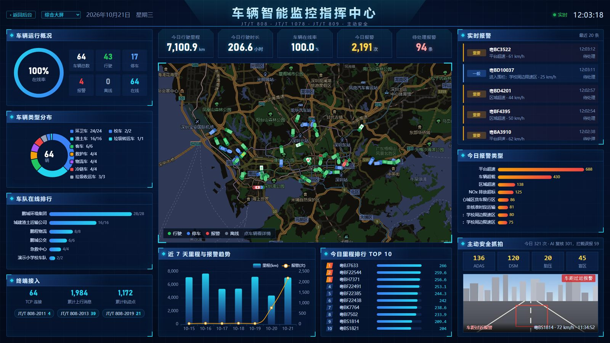
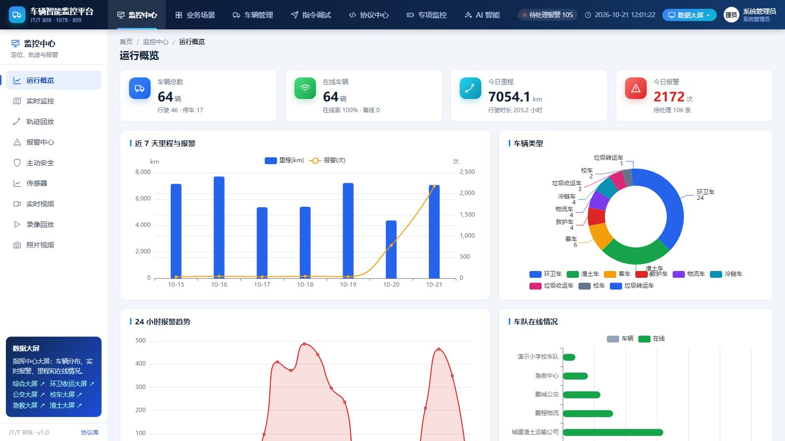
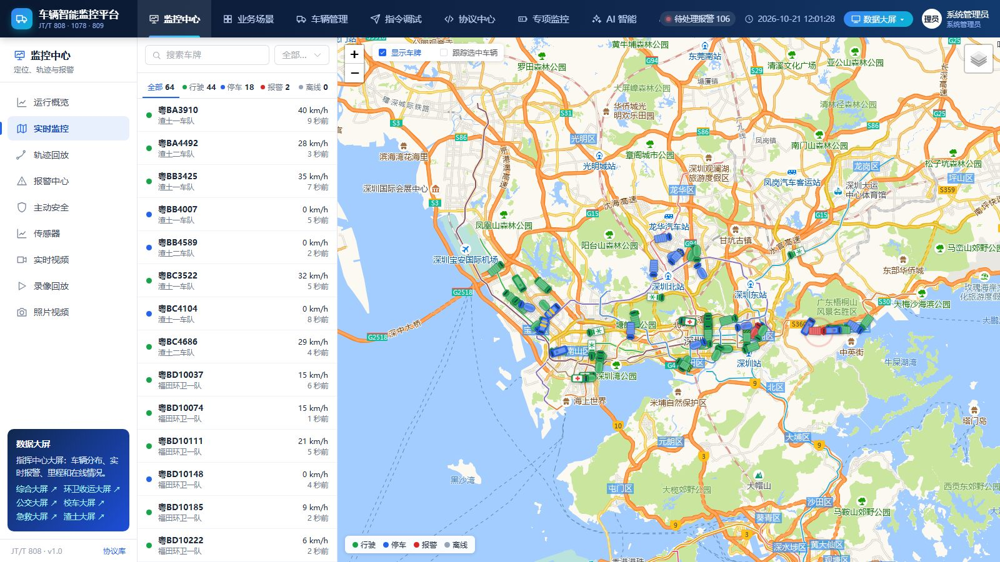
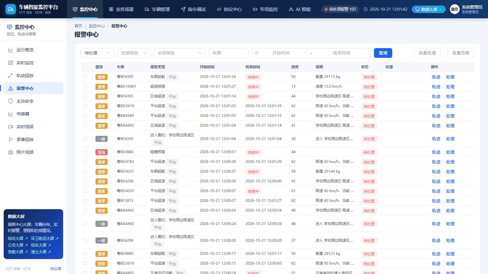
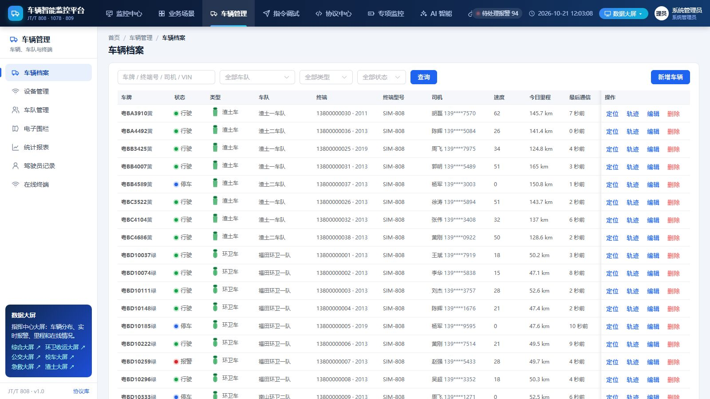
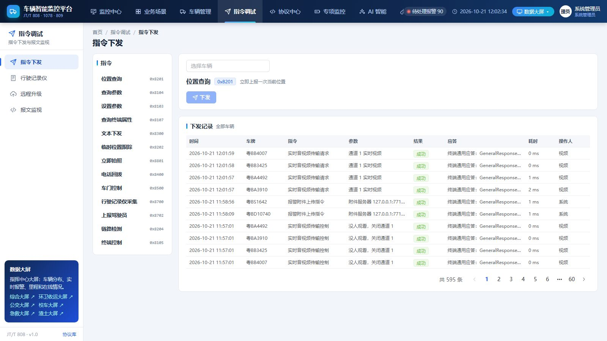
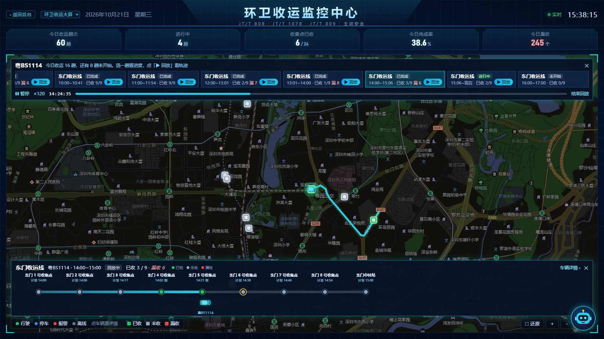

# 车辆监控平台 jt-platform（开源基础版）

基于 JT/T 808 的车辆监控平台：车载终端通过 TCP 接入，2011 / 2013 / 2019 三个版本混接；平台显示实时位置、回放轨迹，终端报警和平台判断的超速进报警中心，监控员处理后可以下发人工确认（0x8203）；查询参数、文本下发、拍照、车门控制等指令在页面上直接发，原始报文按帧标出消息名称。

自带终端模拟器，启动后内置的演示车队沿深圳的真实道路跑起来，没有真机也能把"接入 → 定位 → 轨迹 → 报警 → 处理 → 指令"整个流程跑通。

## 在线体验

演示站：<https://jt.xiaowuiot.com>（完整版，几十辆模拟车一直在跑）

> 🇨🇳 **国内访问优选**：<https://47.119.23.28>（服务器在国内，更快；自签证书，浏览器点"继续前往"即可）。下表里的大屏、手机端把域名换成 `47.119.23.28` 就行，如 <https://47.119.23.28/screen/>。
> 域名 `jt.xiaowuiot.com` 服务器在境外，适合国外或用梯子访问。

| 入口 | 地址 |
|---|---|
| 管理后台 | <https://jt.xiaowuiot.com/> |
| 数据大屏 | <https://jt.xiaowuiot.com/screen/> |
| 环卫收运大屏（还有 bus、school-bus、ambulance、muck） | <https://jt.xiaowuiot.com/screen/?scene=waste> |
| 手机端 | <https://jt.xiaowuiot.com/m/> |

体验账号，密码都是 `demo123`，登录页可以一键登录：

| 账号 | 角色 | 可以体验 |
|---|---|---|
| `monitor` | 监控员 | 实时监控、轨迹回放、报警处理 |
| `dispatch` | 调度员 | 监控 + 指令下发、报文监视 |
| `sanitation` | 环卫公司 | 只看本公司的车（按车队划分数据范围） |
| `manager` | 管理人员 | 看车、看报警和报表 |

代码仓库：GitHub <https://github.com/xiaowu-iot/jt-platform> ，Gitee 镜像 <https://gitee.com/xiaowu-iot/jt-platform>

## 界面截图

截图来自完整版（和演示站一样）。开源版包含其中的运行概览、实时监控、轨迹回放、报警中心、车辆档案、指令下发，具体区别见下面的对照表。

**数据大屏（完整版）**



| 运行概览 | 实时监控 |
|---|---|
|  |  |
| **轨迹回放** | **报警中心** |
|  |  |
| **车辆档案** | **指令下发** |
|  |  |
| **环卫收运大屏（完整版）** | **收运回放（完整版）** |
|  |  |

## 开源版和完整版

这个仓库是开源基础版，拉下来就能跑通上面的流程。

| 功能 | 开源版 | 完整版 |
|---|:---:|:---:|
| 808 接入：2011 / 2013 / 2019 混接、注册鉴权心跳、分包合包、会话管理、上行总线背压 | ✅ | ✅ |
| 位置和轨迹：0x0200 附加信息、0x0704 盲区补传、轨迹按月分表、轨迹回放（倍速、停车点） | ✅ | ✅ |
| 实时监控地图：车辆图标按车型和方向、按车队筛选、看周边 | ✅ | ✅ |
| 终端报警（上升沿开始、下降沿结束）、平台判断超速、报警处理和人工确认 0x8203 | ✅ | ✅ |
| 钉钉群机器人、Webhook 通知 | ✅ | ✅ |
| 指令下发（参数查询设置、位置查询、文本、拍照、车门控制……）、指令记录、报文监视 | ✅ | ✅ |
| 车辆档案、车队分级、设备和 SIM 卡台账、按车队划分数据范围、用户和角色 | ✅ | ✅ |
| 终端模拟器：三个版本、紧急报警、盲区补传、驾驶员插卡、压测 | ✅ | ✅ |
| 主动安全：苏标 / 粤标 ADAS、DSM、胎压、盲区，报警附件服务器 | | ✅ |
| JT/T 1078 音视频：实时视频、录像回放、随路声音、双向对讲、RTMP 转推 ZLMediaKit | | ✅ |
| JT/T 809 上级平台：转发、补报、报警上报、查岗督办、拍照 | | ✅ |
| GB/T 32960 新能源车、HJ 1239 重型柴油车排放 | | ✅ |
| 电子围栏和路线（进出区域、区域超速、偏离路线）、平台判断疲劳驾驶 | | ✅ |
| 透传传感器（胎压、载重、温度）、照片视频、驾驶员记录、行驶记录仪 GB/T 19056 | | ✅ |
| 统计报表、导出 Excel、远程升级（OTA） | | ✅ |
| 业务场景：环卫收运（收运车 / 转运车 / 直运车、到点判定、进度条和回放）、公交、校车、急救、渣土 | | ✅ |
| 数据大屏：综合大屏和五个场景大屏、动效、地图放大和回放 | | ✅ |
| AI：报警复核、AI 助手、安全日报；悬浮机器人「小物」讲解、导出、代填表单；大屏讲解员 | | ✅ |
| 协议中心：808 / 1078 / 809 / 32960 报文解析和构造 | | ✅ |
| 手机端 | | ✅ |
| 部署方案、系统讲解文档 | | ✅ |

完整版源码和系统讲解放在知识星球「小物学长的物联网实战营」里，《项目实战 · 车辆监控平台》专栏从项目骨架讲到部署上线。

## 快速开始

环境：JDK 17+、Maven 3.6+。协议层已随包以 jar 内置（`jt-server/libs/`），无需单独构建协议库：

```bash
mvn clean package -DskipTests
java -jar jt-server/target/jt-server.jar
```

浏览器打开 <http://localhost:8080/>，终端连 TCP 7611 端口。

第一次启动会生成：

- 管理员 `admin`，初始密码随机生成，写在 `data/initial-admin.txt`（登录后尽快改密码并删除该文件；也可以用 `jt.admin-password` 指定）
- 演示数据：几个车队、48 辆车，内置模拟终端沿深圳的真实道路跑（`jt.demo.simulator: false` 关掉）
- 演示账号（密码 `demo123`）：`monitor` 监控员、`dispatch` 调度员、`sanitation` 环卫公司、`manager` 管理人员，登录页可以一键登录

## 走一遍流程

1. 用 `dispatch` 登录，打开「实时监控」，车辆在地图上跑，点一辆车看位置、状态、今日里程
2. 「轨迹回放」选这辆车，播放今天的轨迹，可以倍速、看停车点
3. 另开一个窗口启动模拟器，上线 15 秒后按下紧急报警：
   ```bash
   java -jar jt-simulator/target/jt-simulator-exec.jar jt808 --port 7611 --start 13900000001 --version 2019 --emergency-after 15
   ```
4. 页面右上角弹出报警提醒，「报警中心」里出现这条紧急报警；处理时勾选"下发人工确认报警（0x8203）"，终端清除报警位
5. 「指令下发」选这台终端，查询参数、下发文本、拍照，右侧显示终端的应答
6. 「报文监视」输入终端号 13900000001，看每一帧的原始字节和消息名称

档案里没有的终端注册时会自动建档（`jt.access.auto-register`，生产环境建议关掉），在「设备管理」里能看到待登记的终端。

## 命令行模拟器

```bash
# 1000 台终端，每 10 秒一次位置，每秒建 200 个连接
java -jar jt-simulator/target/jt-simulator-exec.jar jt808 --count 1000 --interval 10 --rate 200
# 2011 版终端，上线 10 秒后驾驶员插卡
java -jar jt-simulator/target/jt-simulator-exec.jar jt808 --version 2011 --driver-card-after 10
# 进盲区 30 秒，出来后用 0x0704 补传
java -jar jt-simulator/target/jt-simulator-exec.jar jt808 --blind-after 20 --blind-seconds 30
```

| 参数 | 默认 | 说明 |
|---|---|---|
| `--host` / `--port` | 127.0.0.1 / 7611 | 平台地址 |
| `--count` | 1 | 终端数量 |
| `--start` | 13800138000 | 第一台终端的手机号，后面依次加 1 |
| `--version` | 2013 | 2011、2013 或 2019 |
| `--interval` / `--heartbeat` | 10 / 60 | 位置上报、心跳间隔（秒） |
| `--rate` | 200 | 每秒建立的连接数 |
| `--emergency-after` | 0 | 上线多少秒后紧急报警，保持到平台确认 |
| `--random-alarms` | | 随机产生超速、疲劳等报警 |
| `--blind-after` / `--blind-seconds` | 0 / 30 | 盲区补传 |
| `--mute-after` | 0 | 上线多少秒后停发数据但不断开（测试离线判断） |
| `--verbose` | | 打印收发的每一条消息 |

模拟终端会应答平台下发的常用指令：参数查询和设置、位置查询、临时跟踪、文本、拍照（照片分包上传）、驾驶员信息、提问、事件、车辆控制。

## 配置

复制 `config/application.yml.example` 为 `config/application.yml` 修改，从项目根目录启动时自动加载。

| 配置 | 默认 | 说明 |
|---|---|---|
| `server.port` | 8080 | 后台端口 |
| `jt.access.port` | 7611 | 808 终端接入端口 |
| `jt.access.idle-seconds` | 180 | 多久没收到数据判离线，心跳间隔的 3 倍 |
| `jt.access.auto-register` | true | 档案里没有的终端注册时自动建档 |
| `jt.access.max-connections` / `max-connections-per-ip` | 0 | 连接数上限，0 不限 |
| `jt.access.rsa-enabled` | false | RSA 消息体加密（0x0A00 / 0x8A00） |
| `jt.bus.capacity` | 100000 | 上行队列容量，满了不回应答，让终端重发 |
| `jt.track.retention-months` | 6 | 轨迹保留几个月（按月分表） |
| `jt.demo.enabled` / `simulator` | true | 演示数据、内置模拟车队 |
| `jt.map.amap-web-key` | | 逆地理编码用的高德「Web 服务」key，不填只显示经纬度 |
| `jt.admin-password` | （空） | 管理员初始密码；留空则随机生成，写到 `data/initial-admin.txt` |
| `jt.data-dir` | ./data | 数据目录（H2 数据库、日志） |

数据库默认 H2 文件库，换 MySQL 改 `spring.datasource`（依赖已经带了 mysql-connector-j）。

## 项目结构

```
jt-simulator/        终端模拟器和压测工具（命令行；平台的内置演示车队也用它）
jt-server/           平台（Spring Boot 3），一个 jar 按 jt.roles 启用 access 接入、platform 平台
  access/            808 接入服务、会话、RSA
  bus/               上行总线：接入和业务隔开，有界队列 + 背压
  platform/ track/   在线状态、最后位置，轨迹攒批写库、按月分表
  alarm/ notify/     终端报警、平台超速、报警处理，钉钉和 Webhook 通知
  command/ api/      指令下发、应答匹配、指令记录，原始报文
  vehicle/ fleet/ device/   车辆档案、车队、设备和 SIM 卡台账
  security/ system/  登录、权限点组合角色、按车队划分数据范围
  resources/static/  管理后台（Vue 3 + Element Plus + Leaflet + ECharts），不需要构建
```

协议层（808 编解码、切帧转义、分包、Netty 服务端）以内置 jar 提供（`jt-server/libs/`），无需单独构建。

技术栈：Spring Boot 3.5、Netty 4.1、Spring Data JPA、Spring Security、H2；前端 Vue 3 + Element Plus + Leaflet + ECharts。

## 测试

```bash
mvn test
```

- `AccessIntegrationTest`：起完整服务端，用模拟器的终端真实 TCP 连上来：2011 / 2013 / 2019 三个版本上线、查询参数、下发文本；紧急报警进报警记录
- `RawFrameViewTest`：原始报文按 7E 切帧、标出消息名称

## 想系统学、做完整的平台？

这个仓库是**基础版**：808 接入、实时监控、轨迹、报警处理、指令下发和模拟器，够你把整个流程跑通。

[在线演示站](https://jt.xiaowuiot.com)跑的是完整版。完整版源码和系统讲解都在知识星球 **「小物学长的物联网实战营」** 里。《项目实战 · 车辆监控平台》专栏从项目骨架讲到部署上线，导读加 24 讲：

| 内容 | 仓库（基础版） | 实战营 |
|---|:---:|:---:|
| 项目骨架、808 接入、位置与轨迹、指令下发、终端模拟器 | ✅ | ✅ 逐讲讲解 |
| 报警与通知、实时监控和轨迹回放、用户车队与数据权限 | ✅ | ✅ 逐讲讲解 |
| 电子围栏、透传传感器、多媒体、行驶记录仪 | | ✅ |
| 主动安全（苏标 / 粤标、附件服务器） | | ✅ |
| JT/T 809 上级平台、查岗督办 | | ✅ |
| JT/T 1078 实时视频、录像回放、对讲、RTMP 转推 | | ✅ |
| GB/T 32960 新能源车、HJ 1239 柴油车排放 | | ✅ |
| 业务场景：环卫收运（到点判定）、公交、校车、急救、渣土 | | ✅ |
| 数据大屏、AI 报警复核和助手、悬浮机器人和大屏讲解 | | ✅ |
| 设备台账与协议中心、部署上线、测试、答疑 | | ✅ |

👉 加入方式：微信扫码加入知识星球「小物学长的物联网实战营」，或者关注公众号「**小物学长**」，回复【星球】。

公众号回复【速查】可以领取《IoT 协议速查手册》PDF。

<p align="center">
  
</p>

<p align="center">
  <br>
  微信扫码关注公众号「小物学长」
</p>

其他开源项目：[env-monitor](https://github.com/xiaowu-iot/env-monitor)（HJ212 环境监测平台）、[iot-protocol-gateway](https://github.com/xiaowu-iot/iot-protocol-gateway)（设备接入网关）、[ai-inspection](https://github.com/xiaowu-iot/ai-inspection)（AI 安全巡检）

## 参与贡献

欢迎提交 Issue 和 PR。如果你手上有真实终端的报文样例（请脱敏后再提交），对完善协议兼容性帮助很大。

## 许可证

[AGPL-3.0](LICENSE)。修改后对外提供服务需要按 AGPL 开放源码；想闭源商用，可以通过公众号联系获取商业授权。
